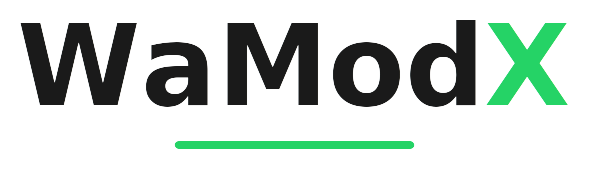
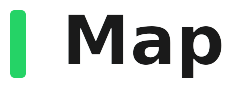
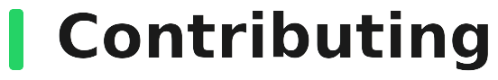
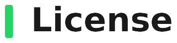

<picture>
  <source media="(prefers-color-scheme: dark)" srcset="./assets/brand/title_dark.png">
  <source media="(prefers-color-scheme: light)" srcset="./assets/brand/title_light.png">
  
</picture>

 

<picture>
  <source media="(prefers-color-scheme: dark)" srcset="./assets/brand/stars_dark.png">
  <source media="(prefers-color-scheme: light)" srcset="./assets/brand/stars_light.png">
  
</picture>

 
 

  
  &nbsp;
  
   
  

  <b>WaModX</b> is an <b>unofficial WhatsApp mod</b> shipped as a <b>standalone APK</b>
  built against hand-written stubs — never against WhatsApp's real classes.

<b>Requirements</b>

 <b>Apktool</b> <code>3.0.2</code> 
 <b>JDK</b> <code>17+</code> 
 <b>Android SDK</b> build-tools (<code>zipalign</code>, <code>apksigner</code>) 
 <b>WhatsApp</b> <code>2.26.36.70</code>

<picture>
  <source media="(prefers-color-scheme: dark)" srcset="./assets/headings/features_dark.png">
  <source media="(prefers-color-scheme: light)" srcset="./assets/headings/features_light.png">
  
</picture>

 

 <b>Anti Revoke Status</b> 
 <b>Anti Revoke Messages</b> 
 <b>Freeze Last Seen</b> 
 <b>Hide Status View</b> 
 <b>Hide Blue Ticks</b> 
 <b>Blue Ticks After Reply</b> 
 <b>Hide Typing / Recording Audio</b> 
 <b>Download Status / Copy Status Text</b> 
 <b>Fix SMS</b> 
 <b>Bypass Anti Ban</b> 
 <b>Anti View Once</b> 
 <b>Design Mods</b>

 

<picture>
  <source media="(prefers-color-scheme: dark)" srcset="./assets/headings/map_dark.png">
  <source media="(prefers-color-scheme: light)" srcset="./assets/headings/map_light.png">
  
</picture>

 

Where each hook lands in the host, one <code>invoke-static</code> per call site.

 <b>Freeze Last Seen</b> → <code>LX/17Q.A00</code>, <code>LX/1cv.A00</code> 
 <b>Hide Blue Ticks</b> → <code>LX/18p.A0O</code>, <code>LX/18p.A0Y</code> 
 <b>Blue Ticks After Reply</b> → <code>SendE2EMessageJob.A0G</code> 
 <b>Read Receipt Job</b> → <code>SendReadReceiptJob.A0G</code> 
 <b>Anti Revoke Messages</b> → <code>LX/1DU.A00</code>, <code>LX/BOY.getDateView</code> 
 <b>Hide Typing / Recording</b> → <code>LX/1im.CCQ</code>, <code>LX/6nE.A01</code> 
 <b>Status Actions</b> → <code>StatusPlaybackContactFragment.A0K</code> 
 <b>Settings Entry</b> → <code>SettingsTabActivity.onResume</code> 
 <b>Fix SMS / Bypass Anti Ban</b> → <code>LX/1Nw.A08</code>, <code>LX/02X.A00</code>, <code>GooglePlayServicesUtil.A01</code>, <code>LX/H4u.A00</code>, <code>LX/00L.A01</code>, <code>LX/HfK.A01</code>

 

<picture>
  <source media="(prefers-color-scheme: dark)" srcset="./assets/headings/contributing_dark.png">
  <source media="(prefers-color-scheme: light)" srcset="./assets/headings/contributing_light.png">
  
</picture>

 

The most useful PR you can send is a stub that stopped matching after a
WhatsApp update. One concern per PR keeps it reviewable, and easy to
revert on its own if it turns out to be wrong.

 <b>Fork</b> your own copy (<a href="https://github.com/SoughtXp/WaModX/fork">fork this repo</a>) 
 <b>Branch</b> one per change 
 <b>Commit</b> one concern per commit 
 <b>Push</b> to your fork 
 <b>Pull Request</b> against <code>main</code> (<a href="../../pulls">open a PR</a>)

 

<picture>
  <source media="(prefers-color-scheme: dark)" srcset="./assets/headings/license_dark.png">
  <source media="(prefers-color-scheme: light)" srcset="./assets/headings/license_light.png">
  
</picture>

Released under the <a href="./LICENSE"><b>MIT License</b></a>.

